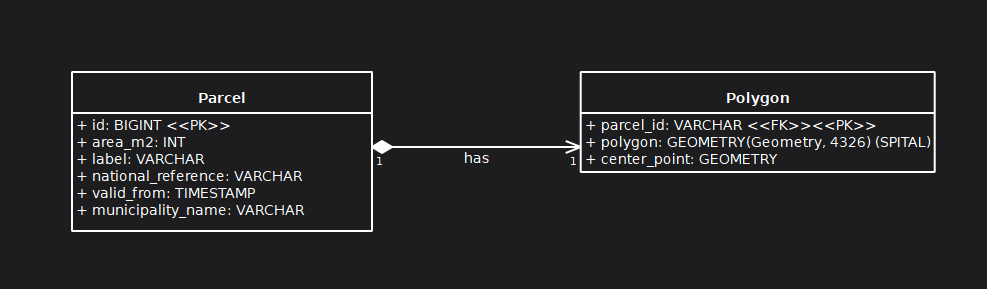
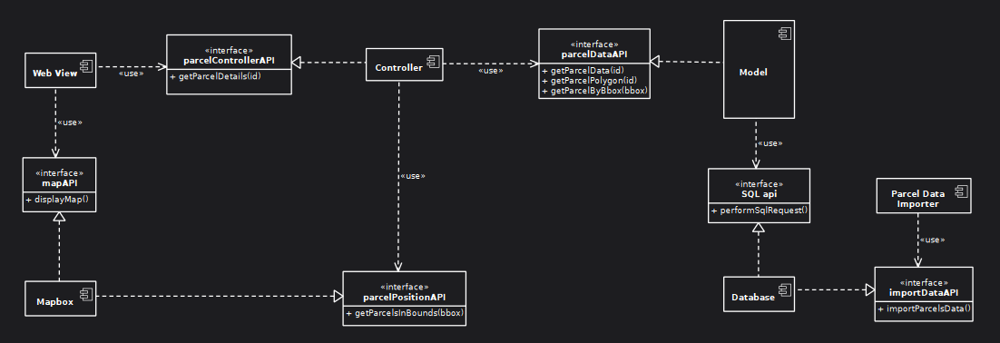

# Mapa parcel - Viagem a.s.

Webová aplikace pro vizualizaci katastrálních parcel nad mapovým podkladem s detailními informacemi po kliknutí

1. Získávání dat: Proč jsem zvolil předběžné stažení

V zadání bylo uvedeno, že nalezení správného endpointu ČÚZK a volba mezi "live" taháním dat a předběžným stažením je na mně. Rozhodl jsem se pro předběžné stažení dat a jejich uložení do vlastní relační databáze.

> Důvod: WFS služby ČÚZK vracejí data ve formátu GML (XML). Pokud bych data tahal "live", musel by backend při každém pohybu mapou odeslat dotaz na ČÚZK, počkat na obrovský XML soubor, ten rozparsovat a překonvertovat do GeoJSONu pro Mapbox. Takový postup by zásadně porušil hlavní požadavek zadání – plynulost a výkon. Lokální databáze mi zaručuje okamžitou odezvu.

2. Architektura databáze a aplikace: Proč dvě tabulky?

Navrhl jsem striktní oddělení dat s vazbou 1:1:

- parcels: Obsahuje pouze lehké popisné informace (id, číslo parcely, výměra). Do této tabulky směřuje dotaz až po kliknutí na konkrétní parcelu.

- parcel_geometries: Obsahuje pouze identifikátor a hmotný polygon (GEOMETRY). Tato tabulka se využívá čistě pro rychlé tahání tvarů do mapy.

> Důvod: Rozdělení tabulek zajišťuje čistotu kódu, zrychluje běžné dotazy a snižuje paměťovou zátěž databázového serveru.



Také před tím než cokoliv psát jsem navrhnul architekuru aplikace v UML Component Diagramu



3. Výkon: Jak jsem vyřešil plynulost nad celým okresem

Pro dosažení absolutní plynulosti i při extrémním oddálení mapy jsem implementoval tři úrovně ochrany:

- Spatial Index (Prostorový index): Nad polygonem v databázi jsem vytvořil SPATIAL INDEX. Databáze díky němu neprochází při vykreslování statisíce záznamů (Full Table Scan), ale použije R-Tree algoritmus k okamžitému nalezení parcel.

- Bounding Box Filtrace: Mapbox neustále posílá na backend souřadnice aktuálního výřezu obrazovky (bbox). Můj PHP kontroler pomocí databázové funkce ST_Intersects vybírá a odesílá pouze ty parcely, které uživatel reálně vidí.

- Zoom Limit Pojistka: V API jsem přidal matematickou kontrolu plochy bounding boxu. Pokud uživatel mapu extrémně oddálí (např. na celou republiku), API bezpečně vrátí prázdnou sadu, čímž zabrání zahlcení paměti prohlížeče a pádu aplikace.

4. Co bych řešil jinak, kdybych měl více času

- Dávkový import (Batch Insert): Aktuální import.php vkládá parcely do databáze po jedné v rámci transakce. Pro celou ČR bych musel napsat dávkové (bulk) vkládání nebo využít nízkoúrovňový nástroj ogr2ogr.

- Caching: Přidal bych Redis, který by si pamatoval již vygenerované GeoJSONy pro často navštěvované výřezy mapy, čímž by se databázi odlehčilo úplně.

### Jak aplikaci spustit (Předpoklady)

Aplikace je navržena pro běh v lokálním prostředí (např. XAMPP) a moderním prohlížeči (Chrome, Firefox)

#### Technické předpoklady:
- PHP: Verze 8.0 a vyšší (čisté PHP bez frameworku)
- Databáze: MySQL (nebo MariaDB) s podporou InnoDB a prostorových indexů (Spatial Index)
- Rozšíření PHP: Povolené PDO (pro databázi) a SimpleXML (pro import dat)
- Mapbox API klíč: Pro běh frontendu je potřeba validní Access Token od Mapboxu vložený do souboru index.html

    
#### Postup instalace:
  1. Naklonujte repozitář (nebo rozbalte ZIP) do vaší lokální složky (např. htdocs/map_app).
  2. Vytvořte databázi map_app 
  ```sql
  CREATE DATABASE IF NOT EXISTS map_app CHARACTER SET utf8mb4 COLLATE utf8mb4_unicode_ci;
  ```
  3. Spusťte SQL skripty pro vytvoření tabulek.
  ```sql
  use map_app;
  
  CREATE TABLE parcels (
      id BIGINT PRIMARY KEY,
      label VARCHAR(255) NOT NULL,
      area_m2 INT,
      national_reference VARCHAR(255),
      municipality_name VARCHAR(255),
      valid_from TIMESTAMP NULL
  ) ENGINE=InnoDB;
  
  CREATE TABLE parcel_geometries (
      parcel_id BIGINT PRIMARY KEY,
      polygon GEOMETRY NOT NULL,
      center_point POINT,
      FOREIGN KEY (parcel_id) REFERENCES parcels(id) ON DELETE CASCADE
  ) ENGINE=InnoDB;
  
  -- TOTO JE ZÁSADNÍ PRO VÝKON A PLYNULOST MAPY:
  CREATE SPATIAL INDEX sp_idx_polygon ON parcel_geometries(polygon);
  ```
  4. Soubor s daty data.gml z ČÚZK je uložen v složce src
  5. Z příkazové řádky spusťte importní skript: php import.php nebo v prohlizeci http://localhost/map_app/api/importer.php
  6. Otevřete v prohlížeči: http://localhost/map_app/
